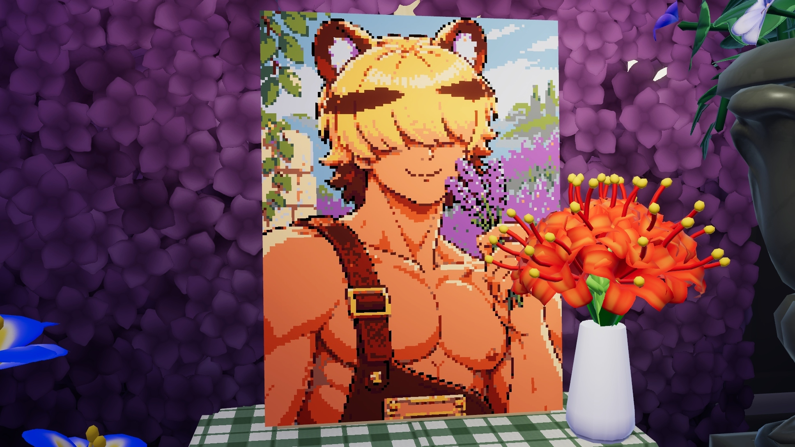
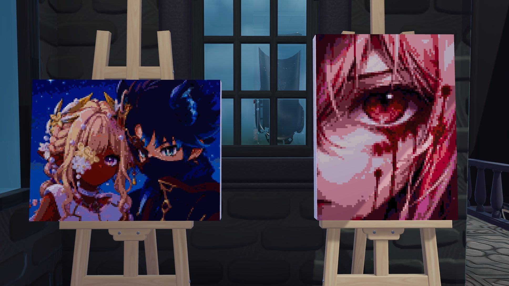
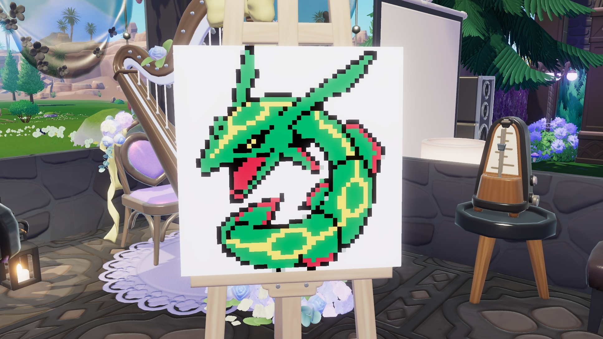

# Dessinopia

Convertit une image et la reproduit automatiquement dans l’atelier de peinture de **Heartopia**.

> Version 1.0.3 pour Windows 11. Ouvrez Heartopia en mode fenêtré sans bordure.

## Télécharger

Téléchargez la dernière archive depuis les
[releases GitHub](https://github.com/Slyreus/Dessinopia/releases), décompressez-la entièrement,
puis lancez `Dessinopia.exe`.

## Exemples de peintures

Peintures réalisées avec Dessinopia et exposées dans Heartopia.

  
  

## Fonctionnalités

- conversion vers les formats et définitions disponibles dans Heartopia ;
- rendu « Pixels nets » ou lissé, taille réelle pour le pixel art et atténuation facultative des points isolés
- palette réglable de 1 à 125 couleurs et intensité réglable pour les tramages Floyd–Steinberg et ordonné
- overlay transparent et calibration visuelle directement sur le jeu ;
- détection et ouverture de l’overlay réunies, avec repères ajustables même sans détection ;
- bandeau horizontal compact, centré en haut et visible en partage d’écran complet ;
- détection automatique de la toile, des palettes, des nuances et des outils ;
- adaptation automatique des repères sauvegardés à la résolution et à la position de l’écran ;
- dessin par traits continus, regroupé par couleur et par zone connexe ;
- contour renforcé puis remplissage central sécurisé pour les grandes zones fermées ;
- tempo « Très lent (anti-surcharge) » pour laisser davantage de temps au jeu entre les gestes ;
- tempos Lent, Prudent, Normal et Rapide pour ajuster le rythme du dessin
- pause/reprise par le bouton ou la touche F8, arrêt F12 et diagnostic détaillé ;
- choix explicite entre reprendre le checkpoint ou réinitialiser à 0 % ;
- mode « Sans échec » déverrouillé après une erreur pour forcer une reprise contrôlée ;
- audit automatique après le tracé, avec retouche des cases vides et des écarts de couleur, puis contrôle après chaque passe.

## Utilisation

1. Ouvrez l’atelier de peinture dans Heartopia.
2. Importez une image et choisissez son format. Pour des contours francs, gardez **Pixels nets** et le tramage **Aucun**. Le mode **Taille réelle (1:1)** place chaque pixel source dans une seule case, avec un recadrage centré si l’image dépasse la toile. **Couleurs max.** limite la palette à 16 nuances par défaut. Après un changement, cliquez sur **Convertir l'image** pour actualiser l’aperçu.
3. Cliquez sur **Détecter / afficher l’overlay**. La grille suit la surface peignable et se recale lorsque la fenêtre change de taille ou d’écran, tant que le dessin est à l’arrêt. Après un changement de toile, cliquez sur **Redétecter la toile** dans le bandeau. **Repères** permet un ajustement manuel.
4. Cliquez sur **Démarrer** pour tester les cinq points au premier lancement du dessin, ou sur **Démarrer sans test** pour utiliser directement les repères affichés.
5. Confirmez le lancement et laissez la souris libre jusqu’à la fin du contrôle. Dessinopia compare la toile à l’image convertie, retouche les écarts et vérifie le résultat. Il effectue jusqu’à trois passes et affiche les cases encore à vérifier.
6. **F8** met l’exécution en pause et **F12** l’arrête. Après une interruption des retouches, **Reprendre les retouches** relit la toile et reprend la correction.

### Choisir le tempo

**Prudent** est le réglage initial, conseillé pour les petits dessins. **Lent** espace davantage les gestes et allonge la durée du dessin. **Très lent** convient aux PC qui peinent à suivre. Une détection reste possible à tout tempo.

**Normal** (anciennement « Équilibré ») et **Rapide** s’utilisent à vos risques et périls. Un avertissement signale le risque de détection pour Normal et un risque potentiellement élevé pour Rapide.

La première exécution doit rester surveillée. Une mise à jour de Heartopia peut modifier son
interface ou ses délais d’animation.

## Licence

Copyright © 2026 Slyreus. Distribué sous licence AGPL-3.0-only.

Heartopia et ses visuels appartiennent à leurs ayants droit. Dessinopia est un outil communautaire
indépendant et non affilié à l’éditeur du jeu.

## Auteur

Créé par **Slyreus** — [paypal.me/FlorianButel](https://paypal.me/FlorianButel)
